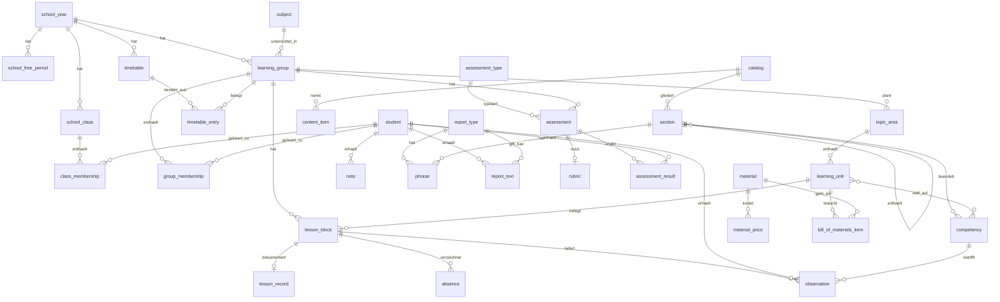

# florg – Datenmodell

Stand: 23.11.2026

Dieses Dokument leitet das Datenmodell aus `docs/konzept.md` ab. Teil 1 zeigt alle Objekte grob über alle sieben Stufen. Teil 2 legt Tabellen und Felder nur für Stufe 1 fest. Die Details der späteren Stufen entstehen jeweils vor deren Umsetzung.

Bezeichner folgen dem Glossar in `docs/konzept.md`, Abschnitt 2.

## Grundsätze

- D1: Die Datenbank ist SQLite. Der Zugriff läuft über eine Zwischenschicht, damit ein späterer Wechsel zu PostgreSQL möglich bleibt.
- D2: Das Schema nutzt nur, was beide Datenbanken können: keine SQLite-Sonderfunktionen, keine dynamische Typisierung, Fremdschlüssel sind eingeschaltet.
- D3: Jede Tabelle hat einen ganzzahligen Primärschlüssel `id`.
- D4: Ein Datum wird als ISO-Text `JJJJ-MM-TT` gespeichert, ein Zeitpunkt als ISO-Text in UTC. Beides lässt sich in PostgreSQL verlustfrei in `DATE` und `TIMESTAMPTZ` überführen.
- D5: Jede Tabelle hat `created_at` und `updated_at`. Sie sind in den Feldlisten unten nicht wiederholt.
- D6: Aufzählungswerte (z. B. Status) werden als englischer Text gespeichert und im Code als Enum geführt.
- D7: Schemaänderungen laufen ausschließlich über Migrationen.
- D8: Es gibt genau ein Konto je Instanz. Tabellen tragen deshalb keinen Besitzer.

## Teil 1: Gesamtmodell (grob)

### Objekte je Stufe

| Stufe | Objekte | Dockt an |
| --- | --- | --- |
| 1 Zeitgerüst | `account`, `school_year`, `school_free_period`, `subject`, `school_class`, `student`, `class_membership`, `learning_group`, `group_membership`, `timetable`, `timetable_entry`, `lesson_block` | – |
| 2 Jahresplanung | `catalog`, `section`, `competency`, `content_item`, `topic_area`, `learning_unit` sowie die Zuordnungen von Kompetenzen zu Lerngruppe, Themenbereich und Lerneinheit | `learning_group`, `lesson_block` |
| 3 Unterrichtsnachweis | `lesson_record`, `absence` | `lesson_block`, `student` |
| 4 Beobachtung | `observation`, `note` | `lesson_block`, `student`, `competency` |
| 5 Zeugnisbemerkungen | `report_type`, `phrase`, `report_text` | `section`, `student`, `learning_group` |
| 6 Noten | `assessment_type`, `assessment`, `grading_scale`, `rubric` mit Kriterien, `assessment_result` mit Kriterienpunkten, Zeugnisnote | `learning_group`, `learning_unit`, `student`, `report_type` |
| 7 Kosten | `material`, `material_price`, `bill_of_materials_item` | `learning_unit`, `school_year` |

### Andockpunkte, die Stufe 1 schon berücksichtigt

- `lesson_block` ist der Anker für Nachweis, Anwesenheit und Beobachtung (Regeln B1, W3). Deshalb bekommt jeder Block eine stabile `id` und wird nie gelöscht, sobald Daten an ihm hängen (Regel D-B4 unten).
- `learning_group` trägt später die Katalogversion (K2), die Kompetenzauswahl (K5), die Themenbereiche und die Leistungsnachweise.
- `student` ist unabhängig vom Schuljahr, damit Beobachtungen über Jahre weiterlaufen (Z9, B10). Die Zugehörigkeit zu Klasse und Lerngruppe ist je Schuljahr eigens gespeichert.
- `lesson_block.learning_unit_id` kommt in Stufe 2 als neues, optionales Feld dazu. Stufe 1 braucht es nicht.

## Teil 2: Stufe 1 im Detail

### account

Das eine Konto der Instanz.

| Feld | Typ | Pflicht | Bedeutung |
| --- | --- | --- | --- |
| `id` | Ganzzahl | ja | Primärschlüssel |
| `username` | Text | ja | Anmeldename, eindeutig |
| `password_hash` | Text | ja | Passwort-Hash, nie das Passwort selbst |
| `display_name` | Text | nein | Name für Ausgaben |

### school_year

| Feld | Typ | Pflicht | Bedeutung |
| --- | --- | --- | --- |
| `id` | Ganzzahl | ja | Primärschlüssel |
| `name` | Text | ja | z. B. "2026/27", eindeutig |
| `start_date` | Datum | ja | Erster Schultag |
| `end_date` | Datum | ja | Letzter Schultag |

### school_free_period

Ferien, Feiertage und andere unterrichtsfreie Tage. Ein einzelner Tag hat gleiches Start- und Enddatum.

| Feld | Typ | Pflicht | Bedeutung |
| --- | --- | --- | --- |
| `id` | Ganzzahl | ja | Primärschlüssel |
| `school_year_id` | Fremdschlüssel | ja | Schuljahr |
| `name` | Text | ja | z. B. "Weihnachtsferien" |
| `kind` | Text | ja | `holiday`, `public_holiday` oder `other` |
| `start_date` | Datum | ja | Erster freier Tag |
| `end_date` | Datum | ja | Letzter freier Tag |

### subject

| Feld | Typ | Pflicht | Bedeutung |
| --- | --- | --- | --- |
| `id` | Ganzzahl | ja | Primärschlüssel |
| `name` | Text | ja | z. B. "Berufs- und Lebensorientierung – Praxis" |
| `short_name` | Text | ja | z. B. "BLO-P", für die mobile Ansicht |

### school_class

Eine Klasse in einem Schuljahr. Die "7a" des nächsten Jahres ist ein neuer Datensatz.

| Feld | Typ | Pflicht | Bedeutung |
| --- | --- | --- | --- |
| `id` | Ganzzahl | ja | Primärschlüssel |
| `school_year_id` | Fremdschlüssel | ja | Schuljahr |
| `name` | Text | ja | z. B. "7a", eindeutig je Schuljahr |
| `grade_level` | Ganzzahl | ja | Jahrgangsstufe |
| `school_name` | Text | nein | Nur nötig, wenn an mehreren Schulen unterrichtet wird |

### student

| Feld | Typ | Pflicht | Bedeutung |
| --- | --- | --- | --- |
| `id` | Ganzzahl | ja | Primärschlüssel |
| `first_name` | Text | ja | Vorname oder Kürzel |
| `last_name` | Text | nein | Nachname; leer bei Arbeit mit Kürzeln |
| `form_of_address` | Text | ja | `he`, `she` oder `name_only` (Regel S7) |

### class_membership

Welcher Schüler in welchem Schuljahr in welcher Klasse ist.

| Feld | Typ | Pflicht | Bedeutung |
| --- | --- | --- | --- |
| `id` | Ganzzahl | ja | Primärschlüssel |
| `student_id` | Fremdschlüssel | ja | Schüler |
| `school_class_id` | Fremdschlüssel | ja | Klasse; das Schuljahr ergibt sich aus der Klasse |

Ein Schüler ist je Schuljahr in höchstens einer Klasse.

### learning_group

| Feld | Typ | Pflicht | Bedeutung |
| --- | --- | --- | --- |
| `id` | Ganzzahl | ja | Primärschlüssel |
| `school_year_id` | Fremdschlüssel | ja | Schuljahr |
| `subject_id` | Fremdschlüssel | ja | Fach |
| `name` | Text | ja | z. B. "7a/b Technik Gruppe 1", eindeutig je Schuljahr |

### group_membership

| Feld | Typ | Pflicht | Bedeutung |
| --- | --- | --- | --- |
| `id` | Ganzzahl | ja | Primärschlüssel |
| `learning_group_id` | Fremdschlüssel | ja | Lerngruppe |
| `student_id` | Fremdschlüssel | ja | Schüler |
| `joined_on` | Datum | nein | Leer bedeutet: seit Schuljahresbeginn |
| `left_on` | Datum | nein | Leer bedeutet: bis Schuljahresende |

Ein Schüler kann in mehreren Lerngruppen sein. Die Datumsfelder decken Wechsel während des Schuljahres ab.

### timetable

Ein Stundenplan mit Gültigkeitszeitraum. Ändert sich der Plan während des Jahres, wird ein neuer Stundenplan angelegt, der den alten ablöst.

| Feld | Typ | Pflicht | Bedeutung |
| --- | --- | --- | --- |
| `id` | Ganzzahl | ja | Primärschlüssel |
| `school_year_id` | Fremdschlüssel | ja | Schuljahr |
| `name` | Text | ja | z. B. "ab September" |
| `valid_from` | Datum | ja | Erster Tag der Gültigkeit |
| `valid_to` | Datum | nein | Leer bedeutet: bis Schuljahresende |

Die Gültigkeitszeiträume der Stundenpläne eines Schuljahres überschneiden sich nicht.

### timetable_entry

Eine einzelne Stunde im Wochenraster.

| Feld | Typ | Pflicht | Bedeutung |
| --- | --- | --- | --- |
| `id` | Ganzzahl | ja | Primärschlüssel |
| `timetable_id` | Fremdschlüssel | ja | Stundenplan |
| `learning_group_id` | Fremdschlüssel | ja | Lerngruppe |
| `weekday` | Ganzzahl | ja | 1 = Montag bis 5 = Freitag |
| `period` | Ganzzahl | ja | Nummer der Unterrichtsstunde am Tag |

Je Stundenplan, Wochentag und Stunde gibt es höchstens einen Eintrag.

### lesson_block

| Feld | Typ | Pflicht | Bedeutung |
| --- | --- | --- | --- |
| `id` | Ganzzahl | ja | Primärschlüssel |
| `learning_group_id` | Fremdschlüssel | ja | Lerngruppe |
| `date` | Datum | ja | Unterrichtstag |
| `first_period` | Ganzzahl | ja | Erste Stunde des Blocks |
| `duration` | Ganzzahl | ja | Dauer in Unterrichtsstunden, mindestens 1 |
| `status` | Text | ja | `planned`, `held` oder `cancelled` |
| `cancel_reason` | Text | nein | Grund bei Ausfall |
| `origin` | Text | ja | `generated` (aus dem Stundenplan) oder `manual` (von Hand angelegt oder geändert) |

Je Lerngruppe, Datum und erster Stunde gibt es höchstens einen Block.

### Regeln zur Erzeugung der Blöcke

- D-B1: Für jeden Schultag eines Schuljahres, der in keiner unterrichtsfreien Zeit liegt, erzeugt florg aus dem an diesem Tag gültigen Stundenplan die Blöcke (Regel Z3).
- D-B2: Aufeinanderfolgende Stunden derselben Lerngruppe am selben Tag ergeben einen Block mit entsprechender Dauer (Z4).
- D-B3: Ändern sich Stundenplan oder unterrichtsfreie Zeiten, werden nur Blöcke neu erzeugt, die in der Zukunft liegen, den Status `planned` haben und den Ursprung `generated`.
- D-B4: Blöcke mit Status `held` oder `cancelled`, Blöcke mit Ursprung `manual` und Blöcke, an denen Daten hängen, werden nie automatisch geändert oder gelöscht. Passt ein solcher Block nicht mehr zum Stundenplan, zeigt florg das als Hinweis an.
- D-B5: Teilen eines Blocks (Z5) verkürzt den bestehenden Block und legt für den Rest einen neuen an. Beide erhalten den Ursprung `manual`.
- D-B6: Das Stundenbudget einer Lerngruppe ist die Summe von `duration` über alle Blöcke, deren Status nicht `cancelled` ist (Z7). Es wird berechnet und nicht gespeichert.

## Bewusst weggelassen in Stufe 1

- **Schule als eigenes Objekt.** `school_class.school_name` genügt. Ein eigenes Objekt lohnt erst, wenn Schulen unterschiedliche freie Tage brauchen.
- **Uhrzeiten der Stunden.** Stunden sind nummeriert. Uhrzeiten können später als eigene kleine Tabelle dazukommen, ohne bestehende Tabellen zu ändern.
- **Samstage und A/B-Wochen.** Nicht vorgesehen.
- **Sitzungen und Passwort-Zurücksetzen.** Das gehört zur technischen Umsetzung des Logins und wird dort entschieden.

## Offene Fragen zu Stufe 1

1. Unterrichtest du an mehreren Schulen mit unterschiedlichen freien Tagen? Dann reicht `school_name` als Text nicht.
2. Gibt es Stundenpläne mit A/B-Wochen oder 14-tägigem Rhythmus?
3. Sollen Ferien und Feiertage von Hand eingetragen werden, oder soll es einen Import geben? Vorschlag: zuerst von Hand, weil es einmal im Jahr etwa 15 Einträge sind.
